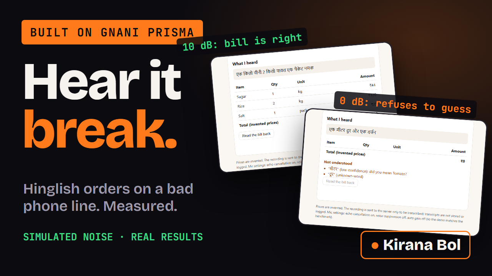
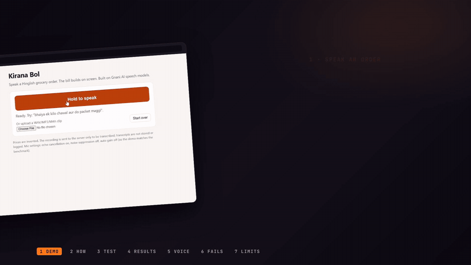
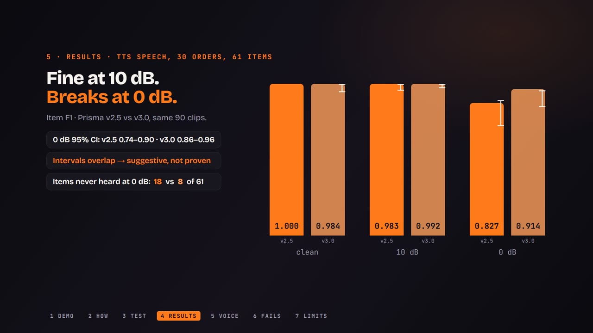
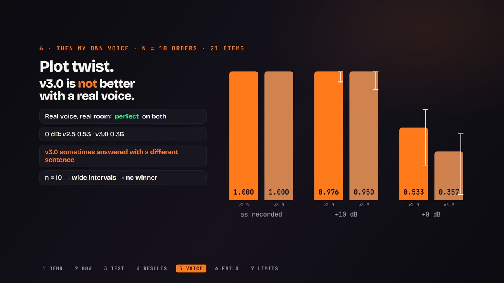
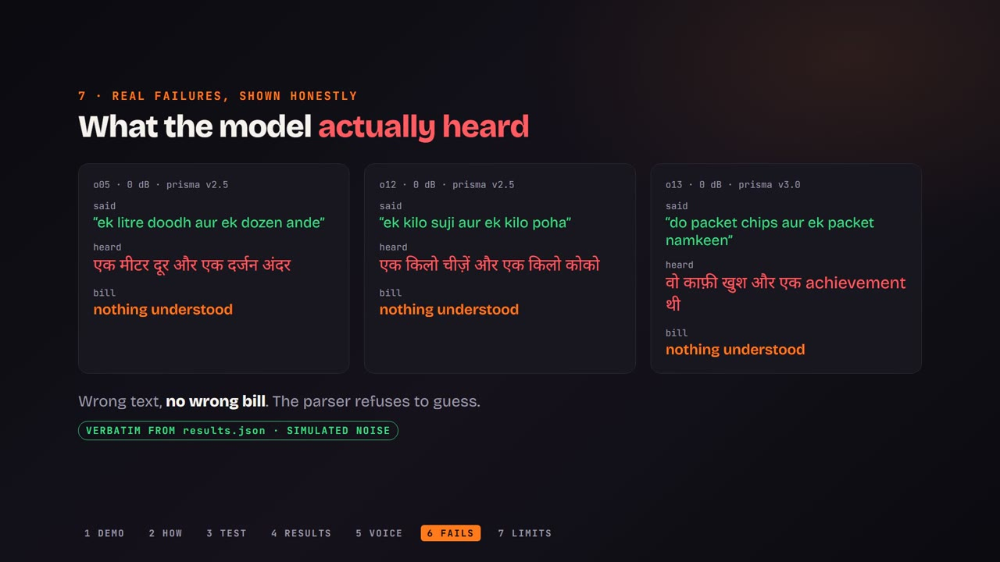
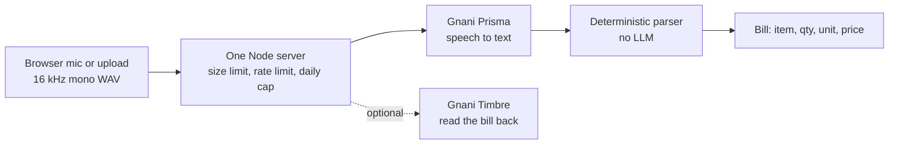
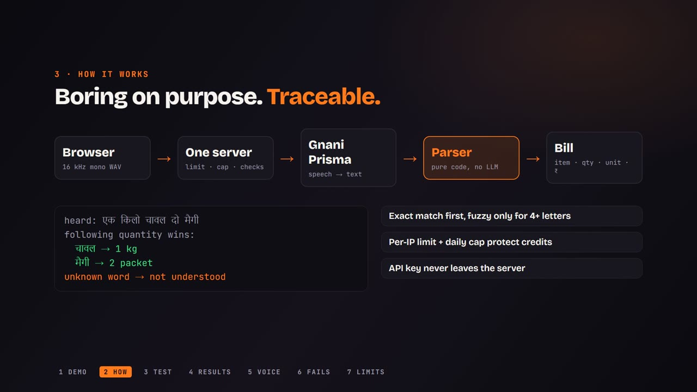
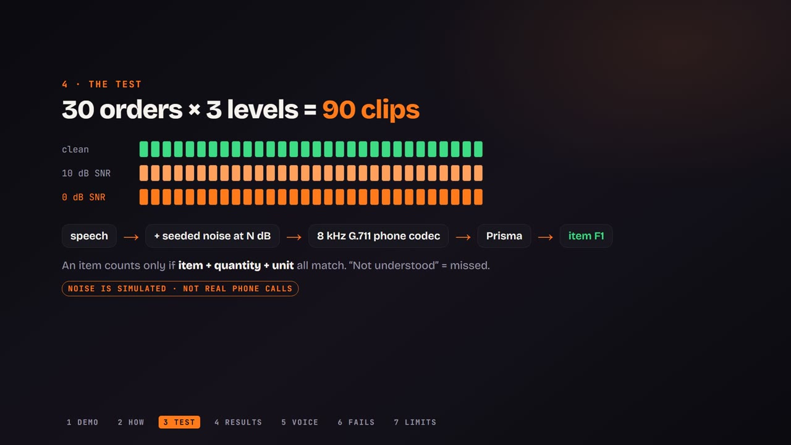

<div align="center">

# Kirana Bol

### Hear Indian speech AI break. Then measure it.

A Hinglish voice order desk for neighbourhood shops, plus a reproducible noise benchmark for **Gnani AI's Prisma** speech model.

[](https://youtu.be/3_k3QTzPp2w)
[](test)
[](docs/BENCHMARK.md)
[](https://docs.gnani.ai/)

<a href="https://youtu.be/3_k3QTzPp2w"></a>

<sub>Click the image to watch the demo on YouTube. Built for the Great Indian AI Internship Challenge.</sub>

</div>

---

## The 20-second version

Say **"bhaiya ek kilo chawal aur do packet maggi"** and the bill builds on screen: item, quantity, unit, price. Then the interesting part: **how does Gnani's Prisma speech-to-text degrade when the audio sounds like a bad phone line?** 90 clips, 2 models, a human-voice run, and every failure shown.

<div align="center">

<br><sub>Real screen recording of the app (live mic), sped up 1.6x. Unedited apart from a crop that removes my browser tabs.</sub>
</div>

## What I found

> Everything below is real output from the Gnani API. The noise is **simulated** (seeded synthetic bed + 8 kHz G.711 telephone codec), not recorded phone calls.

| | clean | 10 dB noise | 0 dB noise |
|---|---|---|---|
| **TTS speech, Prisma v2.5** (30 orders, 61 items) | **1.000** | **0.983** | **0.827** |
| **TTS speech, Prisma v3.0** | 0.984 | 0.992 | 0.914 |
| **My own voice, Prisma v2.5** (10 orders, 21 items) | **1.000** | **0.976** | **0.533** |
| **My own voice, Prisma v3.0** | 1.000 | 0.950 | 0.357 |

*Item F1: an item counts only when item, quantity and unit all match. "Not understood" counts as missed. 95% confidence intervals are in the tables below.*

1. **Fine at 10 dB, breaks at 0 dB**, for both models.
2. **Plot twist.** On TTS speech v3.0 looked better at 0 dB. With **my real voice it was worse** (and sometimes answered with a confident, unrelated sentence). With n=10 the intervals overlap: **no winner claimed.**
3. **The parser refuses to guess.** Wrong transcript, but no wrong bill. Unknown words go to a "not understood" list.

<div align="center">


</div>

### What the model actually heard (verbatim from `results.json`)

<div align="center">

</div>

| said | heard at 0 dB | bill |
|---|---|---|
| "ek litre doodh aur ek dozen ande" | एक मीटर दूर और एक दर्जन अंदर | nothing understood |
| "ek kilo suji aur ek kilo poha" | एक किलो चीज़ें और एक किलो कोको | nothing understood |
| "do packet chips aur ek packet namkeen" (v3.0) | वो काफ़ी खुश और एक achievement थी | nothing understood |

### Honest limits

- The noise is **simulated**; the TTS tables use synthetic speech; my-voice tables are n=10 (wide intervals).
- No comparison model, so **no "best model" claim**.
- The first real run exposed **two parser bugs** (a fuzzy-matching library that treated unrelated Devanagari words as near-identical, and a stray unit corrupting a correct quantity). Both are fixed with regression tests. I fixed them after seeing those transcripts, so treat the numbers as "after one round of fixing on the same set". Details: [`docs/BENCHMARK.md`](docs/BENCHMARK.md).

<details>
<summary><b>Full tables with confidence intervals</b></summary>

**TTS speech, 30 orders, 61 items** (`results.json`, `results.v3.json`)

| Level | v2.5 Item F1 (95% CI) | v3.0 Item F1 (95% CI) | v2.5 STT-attributable misses | v3.0 STT-attributable misses |
|---|---|---|---|---|
| clean (16 kHz) | 1.000 (1.000 to 1.000) | 0.984 (0.949 to 1.000) | 0 | 0 |
| 10 dB + phone chain (SIMULATED) | 0.983 (0.957 to 1.000) | 0.992 (0.974 to 1.000) | 2 | 1 |
| 0 dB + phone chain (SIMULATED) | 0.827 (0.737 to 0.899) | 0.914 (0.855 to 0.960) | 18 | 8 |

**My own voice, real room noise, n=10 orders, 21 items** (`results.human.v2.json`, `results.human.v3.json`)

| Level | v2.5 Item F1 (95% CI) | v3.0 Item F1 (95% CI) |
|---|---|---|
| as recorded (real room noise) | 1.000 (1.000 to 1.000) | 1.000 (1.000 to 1.000) |
| + 10 dB simulated noise + phone chain | 0.976 (0.919 to 1.000) | 0.950 (0.865 to 1.000) |
| + 0 dB simulated noise + phone chain | 0.533 (0.308 to 0.722) | 0.357 (0.095 to 0.545) |

"STT-attributable misses" = expected items whose word never appears in the transcript, so the miss belongs to the speech model, not to the parser's quantity binding. WER is computed too but is secondary (script and number-format differences make it noisy).

</details>

---

## How it works



<div align="center">

</div>

- **Boring on purpose, so every error is traceable.** The parser is plain code: exact alias match first, fuzzy only for 4+ letter words, quantity binds to the item that follows it (a trailing quantity binds back), ambiguous words like "dal" are listed with candidates instead of guessed.
- **Credits are protected.** Per-IP rate limit and a global daily cap run in one process (that is why it is one server, not serverless). The API key never leaves the server and is never logged.
- **Errors are never silent.** Every failure is `application/problem+json` with a stable `code` and a `request_id`.

### The benchmark

<div align="center">

</div>

30 invented orders, each at clean / 10 dB / 0 dB: speech, plus seeded noise at a target SNR, then an 8 kHz G.711 phone codec, then Prisma, then the parser, then scoring. The mix test asserts the measured SNR is within 0.5 dB of the target. Method and schema: [`docs/BENCHMARK.md`](docs/BENCHMARK.md).

---

## Quickstart (about 3 minutes with a key)

Needs Node 20+ and, for the benchmark noise levels, [ffmpeg](https://ffmpeg.org/).

```bash
git clone https://github.com/Guten-Morgen1302/kirana-bol.git
cd kirana-bol
npm install
cp .env.example .env        # Windows PowerShell: Copy-Item .env.example .env
# edit .env: set GNANI_API_KEY (get one at https://app.gnani.ai/voice)
npm test                    # 57 tests, no network, no key needed
npm run dev                 # http://localhost:3000
```

No key yet? `npm test` and `npm run bench:mock` run without one (the mock run proves the plumbing; its numbers are labelled MOCK and say nothing about Gnani).

<details>
<summary><b>Try the parser alone, call the API, run the benchmark</b></summary>

```bash
# parser only, no key
node -e "import('./lib/parser.js').then(m=>console.log(JSON.stringify(m.parseOrder('ek kilo chawal aur do packet maggi').lines.map(l=>[l.name,l.qty,l.unit]))))"
# expected: [["Rice",1,"kg"],["Maggi noodles",2,"packet"]]

# call the API (16-bit PCM WAV)
curl -s -X POST -H "Content-Type: audio/wav" --data-binary @clip.wav http://localhost:3000/api/order

# benchmark
npm run bench -- --dry-run --levels clean,10           # how many minutes of audio will be sent
npm run bench -- --source tts --levels clean,10,0      # real run -> results.json + results.md
npm run bench -- --source dir --clean-dir data/human   # your own recordings (see docs/RECORDING.md)
npm run bench -- --rescore --out results.json          # re-score stored transcripts, no API calls
```

Add `--resume` to continue after an interruption. Exit code 1 means some clips failed (the table shows `n failed`).

</details>

<details>
<summary><b>Repo map</b></summary>

| Path | What |
|---|---|
| `server.js`, `public/` | the one-process server and the browser page |
| `lib/parser.js`, `catalog.json` | deterministic Hinglish parser and the invented 40-item catalog |
| `lib/noise.js`, `lib/score.js`, `bench.js` | noise mixing, telephone chain, scoring, benchmark CLI |
| `lib/gnani.js` | Gnani STT/TTS client (retries only 429/5xx, never echoes the key) |
| `data/orders.json` | the 30 invented orders with ground truth |
| `results*.json`, `results.md` | the real results behind every number above |
| `test/` | 57 tests (parser, scoring, noise, server, benchmark) |
| `video/` | Remotion source of the demo video |
| `docs/` | [SPEC](docs/SPEC.md), [ARCHITECTURE](docs/ARCHITECTURE.md), [BENCHMARK](docs/BENCHMARK.md), [DATA](docs/DATA.md), [DEPLOY](docs/DEPLOY.md), [DECISIONS](docs/DECISIONS.md) |

</details>

---

## Honesty notes

- **Reviews:** this project went through structured plan reviews (CEO, DX, Eng) before any code. Every "outside voice" was a second Claude instance, not an external model; the raw records are in [`docs/review/`](docs/review/) and the decisions in [`docs/DECISIONS.md`](docs/DECISIONS.md).
- **Built with AI assistance** (Claude Code). The idea, recordings, key and final calls are the author's; tests and real API runs verify the code.
- **Privacy:** prices and orders are invented; transcripts are not stored or logged; the demo video crops out the author's browser tabs.

## Links

[Demo video](https://youtu.be/3_k3QTzPp2w) · [Gnani API docs](https://docs.gnani.ai/) · [Gnani Discord](https://discord.gg/aECcvtABpq) · [`TODOS.md`](TODOS.md) (what was deliberately left out) · License: MIT (`LICENSE`)

<div align="center"><sub>#GnaniAI #GreatIndianAIInternshipChallenge</sub></div>
